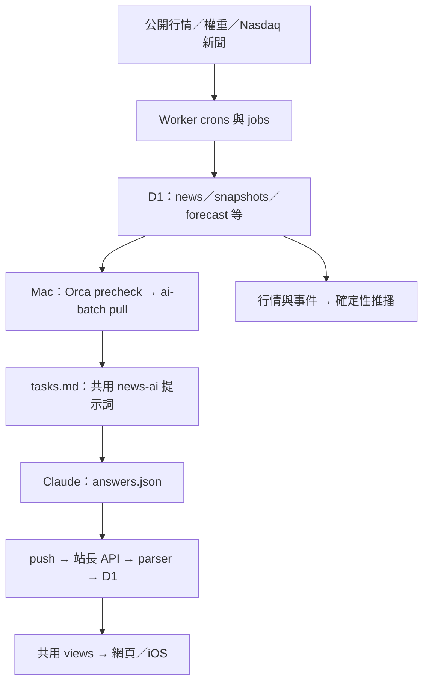

# 任務 J：判斷流水線與 agent skills 的優化

查核日：2026-10-28。結論：先補「這批內容從哪裡來、是否完整寫入、能否重現與評分」，再增加少量維護 skills。現有新聞 AI 的主要缺口不是缺少金融 agent，也不是需要更多市場預測輸入。

本報告只有研究與靜態盤點；未修改程式、技能或排程，未呼叫正式站 `/api/admin/*`，未讀正式 D1，未執行任何市場歷史回測或探索統計。另執行了現有、使用合成資料與記憶體 SQLite 的新聞測試，結果列於 §6。本文的工程提案尚未驗證成效，證據等級一律 `none`；不能把「讀到程式缺口」升格成「已證明某方案有效」。

## 1. 查核範圍與現況

### 1.1 來源與判讀約定

本地程式以查核當下 checkout、commit `99066fd3ad63ec7b040f6fd447f255b2d3c3964a` 為準；親自開啟本文引用的檔案。以下程式數值均為 **2026-10-28 的設定／行為觀察**，不是市場實證。repo 相對路徑後的數字為行號。可對照的固定版本入口：

- [本機 batch 腳本](https://github.com/audichuang/market-observatory/blob/99066fd3ad63ec7b040f6fd447f255b2d3c3964a/web/scripts/ai-batch.ts)、[D1 待辦與匯入](https://github.com/audichuang/market-observatory/blob/99066fd3ad63ec7b040f6fd447f255b2d3c3964a/web/src/server/ai-batch.ts)、[全部新聞提示詞與 parser](https://github.com/audichuang/market-observatory/blob/99066fd3ad63ec7b040f6fd447f255b2d3c3964a/web/src/lib/news-ai.ts)。
- [Worker 工作順序](https://github.com/audichuang/market-observatory/blob/99066fd3ad63ec7b040f6fd447f255b2d3c3964a/web/src/server/jobs.ts)、[D1 schema](https://github.com/audichuang/market-observatory/blob/99066fd3ad63ec7b040f6fd447f255b2d3c3964a/web/db/schema.ts)、[共用 views](https://github.com/audichuang/market-observatory/blob/99066fd3ad63ec7b040f6fd447f255b2d3c3964a/web/src/server/views.ts)。
- [事前登記正本](https://github.com/audichuang/market-observatory/blob/99066fd3ad63ec7b040f6fd447f255b2d3c3964a/web/docs/forecast.md)、[上一輪提案](https://github.com/audichuang/market-observatory/blob/99066fd3ad63ec7b040f6fd447f255b2d3c3964a/web/docs/research-2026-10-27/proposal.md)、[上一輪審查](https://github.com/audichuang/market-observatory/blob/99066fd3ad63ec7b040f6fd447f255b2d3c3964a/web/docs/research-2026-10-27/codex-review.md)。
- [verify 入口](https://github.com/audichuang/market-observatory/blob/99066fd3ad63ec7b040f6fd447f255b2d3c3964a/.claude/skills/verify/SKILL.md)、[功能地圖索引](https://github.com/audichuang/market-observatory/blob/99066fd3ad63ec7b040f6fd447f255b2d3c3964a/.claude/skills/verify/features/README.md)。GitHub 網址供整合者定位；本輪程式事實的直接證據來自本地檔案，不宣稱這些連結已驗證為匿名可讀。

外部資料均附一手網址。產品文件未標發布日者，日期指本輪查閱日。本文所列抽樣頻率、驗收門檻與排程調整都是 **2026-10-28 提案的維護政策**，不是文獻校準的最佳值。`none` 表示成效未建立，並不等於統計上的零效果。

### 1.2 實際資料路徑



**推播目前沒有讀新聞 AI 摘要。** `web/src/server/push.ts:230` 用快照呼叫 `dailySummary`／`bigMoves`，`web/src/lib/push.ts:42` 組合指數、名單與貢獻數字。故 Mac 的新聞 AI 中斷不會直接阻止這條收盤推播；不能把背景中的流程圖理解成「AI 寫完才推播」。來源：[推播工作](https://github.com/audichuang/market-observatory/blob/99066fd3ad63ec7b040f6fd447f255b2d3c3964a/web/src/server/push.ts#L230)、[推播文字](https://github.com/audichuang/market-observatory/blob/99066fd3ad63ec7b040f6fd447f255b2d3c3964a/web/src/lib/push.ts#L42)，查核日 2026-10-28。

Worker 的 `news` 排程只跑新聞抓取與分析師共識；價格排程接收盤推播，另有補抓。`web/src/server/jobs.ts:770`。新聞每隔四小時抓一次，見 `web/crons/news.ts:5`；本機只負責 AI 加工，不負責行情可用性。來源：[新聞 cron](https://github.com/audichuang/market-observatory/blob/99066fd3ad63ec7b040f6fd447f255b2d3c3964a/web/crons/news.ts#L5)，查核日 2026-10-28。

### 1.3 本機 Orca 設定快照

2026-10-28 唯讀執行 `orca automations list --json`，只採用名稱以「市場觀測室：」開頭的設定。這是本機 runtime 的一手輸出，沒有公開網址；不是 repo 版控內容。

| 排程 | 實際設定 | 意義 |
|---|---|---|
| 市場觀測室：新聞標題翻譯 | `20 0,4,8,12,16,20 * * *`；`Asia/Taipei`；`--model haiku`；precheck=`pull translate --check` | 有待辦才叫模型；alias 未證明為固定 model snapshot |
| 市場觀測室：每日 AI 重點 | `0 7 * * 2-6`；`Asia/Taipei`；`--model sonnet`；precheck=`pull daily --check` | agent 開始後先補翻譯，再重新 pull daily；precheck 卻先看 daily |
| 共通 | `executionTargetType=local`、`schedulerOwner=local_host_service`、`workspaceMode=existing`、`reuseSession=false`；漏跑政策 `run_once_within_grace`，寬限 `720` 分鐘 | 依賴本機與主 checkout；設定可證明政策存在，不能證明關機後已成功補跑 |
| 使用量 | 兩者最後狀態均為 `completed`；`estimatedCostUsd=null`、`knownRuns=0`，另有 `unavailableRuns` | 缺使用量資料；顯示的 token 零值不能解讀成免費或未消耗額度 |

可重查的 automation IDs：翻譯 `08e79897-22c8-4835-af38-9d0140417a5e`；daily `b5c65aa3-c7ca-46b6-b3c6-be429c1444e5`。本輪沒有執行、編輯或新增排程，也未用排程狀態替代 D1 寫入確認。

### 1.4 四種提示詞、輸入與實際驗證

| 工作 | 目前輸入與要求 | 現有驗證的範圍 |
|---|---|---|
| `enrichPrompt` | 英文標題、截短摘要、掛載代號、primary symbol；翻譯、tone、category、focus。`web/src/lib/news-ai.ts:76` | `parseEnrich` 過濾不存在序號與 focus，修正不合法分類／tone；不判定翻譯是否忠實。`:106` |
| `digestPrompt` | 當日股價／點數與公司新聞；允許原因不明、禁止自行前瞻。`:132` | `parseDigest` 檢查最短文字、截長、tone；不核對數字或因果出處。`:260` |
| `marketPrompt` | 收盤、VIX、等權差、名單貢獻與大盤新聞標題。`:172` | 與公司 digest 共用 parser；沒有逐句來源、時間或 breadth 語意判定 |
| `pointsPrompt` | 文章正文、標題與相關代號；禁止投資建議。`:207` | `parsePoints` 接受非空字串陣列、截長／截筆數、修正 tone；不核對內容。`:220` |

上述為 2026-10-28 的程式觀察，[提示詞／parser 原始碼](https://github.com/audichuang/market-observatory/blob/99066fd3ad63ec7b040f6fd447f255b2d3c3964a/web/src/lib/news-ai.ts)。JSON Schema 是給 agent 看，匯入時用自訂 parser，並非完整執行同一份 Schema 的驗證；部分缺欄位仍可能被預設值接受。

正文取得流程已經比「只看標題猜重點」保守：`web/scripts/ai-batch.ts:111` 對 Yahoo 同標題轉載，`:163` 只有取得正文才建立 points 任務。`pointsPrompt` 雖保留無正文分支，**目前這個 batch 呼叫路徑不會因此替無正文新聞寫摘要**。不建議再加一次標題 fallback。

## 2. 流水線的具體缺口

以下區分「程式可見的結果」與「正式站發生率」。本輪沒有正式 D1 與故障 log，不能聲稱已觀察到使用者受害或估計事故頻率。

### 2.1 可靠性與完整性

| 具體輸入／狀態 | 現在會怎樣 | 影響與建議方向 |
|---|---|---|
| Mac 關機，或 Claude 已無可用額度 | 本機不會完成 pull→生成→push；Worker 仍可抓資料。現有 repo 腳本沒有另一個 AI 執行者 | 保留非 AI 資料；記錄 AI 缺漏與最後成功批次。先補觀測，不直接搬到付費 API；實際漏跑補償未核實 |
| daily 已有全部 digest、剩下新聞尚未翻譯且 `focus=null`，沒有可取正文的 points | precheck 的 daily 待辦可能為空，agent 不啟動，連它原定的補翻譯步驟也不執行 | precheck 應檢查「翻譯或 daily 是否有工作」，或把翻譯依賴移到確定性 coordinator。依據 `web/src/server/ai-batch.ts:79`、`:88`、本輪 Orca prompt |
| `pull` 完成後尚未 push，又執行同 kind 的 `pull` | 固定目錄的 `answers.json` 直接清成空物件，`tasks.json`／`tasks.md` 被覆寫。`web/scripts/ai-batch.ts:194` | 已產生答案與當時輸入無法靠該目錄保留；採不可覆寫的 run 目錄。這是具體覆寫路徑，不必先假設高機率並發事故 |
| 答案缺任務、parser 略過，或少數翻譯列格式不對 | push 對缺答案列 warning，server 回 skipped；腳本沒有因此設非零 exit。`web/scripts/ai-batch.ts:221`、`web/src/server/ai-batch.ts:139` | 排程 completed 不等於完成全部工作；應回報 expected／accepted／missing／rejected，將 partial 與 success 分開 |
| points 指向已不存在的 news id | SQL UPDATE 可沒有命中，仍遞增 `points` 計數。`web/src/server/ai-batch.ts:177` | 現有「寫入筆數」不是逐列讀回證明；以實際命中或讀回結果作 receipt |
| `parsePoints` 收到 JSON 字串而不是物件 | 它與其他 parser 不同，直接讀 `.points`，可能略過；本機會先 parse 頂層字串答案，但其他匯入 caller 未必相同 | 接口應固定答案型別，測清邊界；不用為所有想像型別增補防禦 |
| 已有某交易日 digest，後來才取得重要新聞或更正來源 | `dailyWork` 以 `(symbol,date)` 已存在就不再給，未比較 fingerprint。`:88`、`:93`、`:109` | 不是「新聞有變就自動重寫」。先保留原稿；需要更正時建立可追溯修訂，不能以「重跑」當作已會補更新 |
| Mac 漏過幾個交易日後恢復 | daily 只取最新快照，並非逐日補齊。`:84` | 明確區分當日可用性與歷史完整性；不自動補造當時已發布的內容 |
| 文章抓不到，或 Yahoo 搜尋失敗 | points 不建立；部分錯誤被轉成空清單／null。`web/scripts/ai-batch.ts:95`、`:111` | 保留現在「不寫」的行為，但 receipt 應區分 source unavailable 與沒有候選，免得把資料缺失當低需求 |

來源：[本機流程](https://github.com/audichuang/market-observatory/blob/99066fd3ad63ec7b040f6fd447f255b2d3c3964a/web/scripts/ai-batch.ts)、[待辦／匯入流程](https://github.com/audichuang/market-observatory/blob/99066fd3ad63ec7b040f6fd447f255b2d3c3964a/web/src/server/ai-batch.ts)，查核日 2026-10-28。這些是靜態可達狀態；本輪沒有以正式站資料觸發它們。

**不建議現在增加無限重試或自動換模型。** server 註解說略過後下次再給，但翻譯與 points 有日期窗口，daily 只看最新快照；「下次會補」有條件，也可能一直重試同一壞輸出。應先有批次 receipt 與明確失敗分類，再由維護者決定重跑。未見額度耗盡的實際 log，不能主張某 fallback 已有必要。

### 2.2 追溯性、成本與呈現

- **已有 Git prompt 版本，缺 output→版本的連接。** `news-ai.ts` 在版控，但 `news_digests` 只存 `model`、新聞 id 指紋與建立時間；model 預設為 `claude-orca`，沒有實際 alias、model snapshot、commit、prompt hash、輸入正文 hash。翻譯與 points 更沒有逐筆模型紀錄。`web/scripts/ai-batch.ts:216`、`web/db/schema.ts:71`、`:85`。新聞 id 指紋不能證明文章內容、順序、權重快照與 prompt 都相同。
- **生成後無法還原當時證據。** Yahoo 匹配後使用的實際轉載網址、擷取版本與截斷正文沒有跟結果寫入。`web/scripts/ai-batch.ts:111` 只回正文。D1 的 `news_ids` 尚未透過 `latestDigests` 傳到 UI；`web/src/server/news-ai.ts:17` 只回公司、日期、摘要、tone。即使想月抽查，現在也可能找不到原始輸入。
- **有節流，沒有可證明的單位成本。** precheck、批量標題、只對重要新聞抓正文、已寫過不再給，都在降低工作量；但 Orca 的成本欄為 null。不能把 Claude 訂閱說成零成本，也不能計算每篇美元成本。先記任務量、端到端時間、quota failure、可取得的 usage、accepted 結果；費用未知就保留未知。
- **UI 與註解仍有舊描述。** `web/pages/news.tsx:21` 寫「在你打開時由 AI 翻成中文」；`web/src/server/views.ts:82`、`:356` 也有舊註解，但實際只讀 D1。網頁 `web/src/ui/NewsFeed.tsx:78` 有 digest 日期，iOS `ios/MarketObservatory/Views/NewsAI.swift:169` 的公司 DigestRow 未顯示日期。這值得以舊摘要 fixture 驗證讀者能否辨識新舊，不能直接聲稱所有介面都缺日期。

本段為 2026-10-28 程式觀察，來源：[schema](https://github.com/audichuang/market-observatory/blob/99066fd3ad63ec7b040f6fd447f255b2d3c3964a/web/db/schema.ts)、[新聞讀取](https://github.com/audichuang/market-observatory/blob/99066fd3ad63ec7b040f6fd447f255b2d3c3964a/web/src/server/news-ai.ts)、[新聞頁文字](https://github.com/audichuang/market-observatory/blob/99066fd3ad63ec7b040f6fd447f255b2d3c3964a/web/pages/news.tsx#L21)、[iOS DigestRow](https://github.com/audichuang/market-observatory/blob/99066fd3ad63ec7b040f6fd447f255b2d3c3964a/ios/MarketObservatory/Views/NewsAI.swift#L169)。

### 2.3 Hindsight、因果與信任邊界

`digestPrompt` 與 `marketPrompt` 先給結果，再要求說明，仍有依價格選故事的可能；**這是待測假設，不是本輪證明的錯誤率**。重排輸入不能證明消除了 hindsight。

更直接的問題是缺時間與出處：`web/src/lib/sources/nasdaq.ts:106` 只解析年月日；`web/src/server/ai-batch.ts:91` 用同一日期選新聞；market 只拿標題，沒有來源段落或具名解釋。股價、VIX 與等權差能描述共變與算術結構，不能證明投資人動機；等權落後也不能證明多數股票下跌。來源：[Nasdaq 日期解析](https://github.com/audichuang/market-observatory/blob/99066fd3ad63ec7b040f6fd447f255b2d3c3964a/web/src/lib/sources/nasdaq.ts#L106)、[market 輸入](https://github.com/audichuang/market-observatory/blob/99066fd3ad63ec7b040f6fd447f255b2d3c3964a/web/src/server/ai-batch.ts#L108)，查核日 2026-10-28。

外部文章會直接進 `tasks.md` 的內容區，現有 prompt 未明確把其中指令標成不可信資料。Orca prompt 有只准寫 answers 與執行 push 的文字限制，但本輪未核實實際工具權限是否也如此限制。應用已知正文輸入路徑測「文章內要求改程式／洩漏帳密／執行 shell」的拒絕行為，屬信任邊界驗證；**沒有觀察到已被攻擊**，也不因此擴大成整站安全稽核。

## 3. 上一輪 N-01～N-09 的落實狀態

判定基準為 2026-10-28 本地 source；不是正式部署狀態。以 `web/docs/research-2026-10-27/codex-review.md:67` 的修正版為準，避免重抄被審查推翻的原提案。

| 原 ID | 現況 | 本輪新增判斷與驗收缺口 |
|---|---|---|
| N-01 | 未照原提案重排；`marketPrompt` 仍先列收盤結果，`:184` | 不把換順序當有效方法；先做同證據、不同結果提示的合成 eval |
| N-02 | 已加允許「沒有可清楚辨識的單一催化因素」；`:142`、`:193` | 現有測試只證明字句存在，未證明模型會在不確定時使用 |
| N-03 | 已移除「可能怎麼影響股價」，改成事件與具名人士說法；`:141` | 尚無逐句來源評估；規則存在不等於不會越界 |
| N-04 | 指定 source／測試／skill 範圍未見正式輸出抽查或條件式證據檢查 | 本輪未讀正式 digest，不能宣稱已發現這類錯誤；不加因果詞黑名單 |
| N-05 | 已傳全部 movers，prompt 列主要公司與未列公司合計；`:173`，server `:121`；近似誤差語意已改 | 已有合成加總測試；不用重做。仍不能從有限名單推導全市場普漲普跌 |
| N-06 | CPI／非農日曆與分種類的工作摘要已做；`web/src/lib/calendar.ts:180`、`:183` | `MarketInput` 未增加 `macroToday`；不因日曆存在就自動生成「事件造成漲跌」 |
| N-07 | 尚無 `published_ts`，prompt 亦未明確限制未知時間不得寫盤中反應 | 優先修。先查上游實際時間欄；沒有就標 unknown，不能預設盤前 |
| N-08 | 未加 `cause_status` | 符合修正版「暫不做」。先內部 claim 標註與抽查，不急著改 API／iOS 模型 |
| N-09 | 指定 source／測試／skill 範圍未見月抽查產物或黃金樣本集 | 抽查是維護流程缺口；不要把 unclear 比例調到某個目標 |

來源：[現行提示詞](https://github.com/audichuang/market-observatory/blob/99066fd3ad63ec7b040f6fd447f255b2d3c3964a/web/src/lib/news-ai.ts)、[合成測試](https://github.com/audichuang/market-observatory/blob/99066fd3ad63ec7b040f6fd447f255b2d3c3964a/web/tests/news-ai.test.ts#L131)、[日曆](https://github.com/audichuang/market-observatory/blob/99066fd3ad63ec7b040f6fd447f255b2d3c3964a/web/src/lib/calendar.ts#L180)。本輪搜尋 `web/src`、`web/scripts`、`web/tests`、`.claude/skills` 中的抽查、golden、faithfulness、promptfoo、prompt hash、cause status、時間戳相關詞；這個搜尋範圍不能排除 repo 外另有手工紀錄。

## 4. 一手外部證據：值得借什麼、不證明什麼

### 4.1 評估方法與金融場景

| 一手來源／日期 | 實際支持的內容 | 證據等級、結果與適用範圍 |
|---|---|---|
| Gao et al., *Enabling Large Language Models to Generate Text with Citations*，EMNLP，2023-12。[論文 §3.3、§6](https://aclanthology.org/2023.emnlp-main.398.pdf) | 分開評估答案正確性、citation recall、citation precision；事後補引用不等於來源支持。論文也找到互動檢索未改善該 benchmark 的負面結果 | `academic_oos`；負：特定互動檢索／事後補引用不能自動解決問題。一般問答的保留評估集，非市場期限、非資產報酬、非橫斷面選股；可借評分定義，不能移植成金融品質保證 |
| Reche et al., *Financial News Summarization: Can extractive methods still offer a true alternative to LLMs?*，2025-12-09。[原文 §3.4、§4](https://arxiv.org/html/2512.08764) | 使用 ROUGE／BERTScore 比較金融新聞摘要，並指出參考摘要品質有問題；高相似度分數可能對應不可用摘要 | `academic_oos`；正：部分模型在保留測試集的文字相似度改善；負：該 proxy 不足以證明摘要可用。這不是交易 OOS、沒有報酬期限，也不是選股。無從據此宣稱 hallucination 已受控 |
| Koijen & Levy, *Assessing the Benefits of Optimized Agentic AI Systems for Asset Pricing*，NBER WP，2026-07。[原始摘要](https://www.nber.org/papers/w35431) | 作者以公告時可得資訊評估財報事件附近的 contemporaneous 個股報酬，採 real-time OOS benchmark；比「看到已實現漲跌再講故事」更能區分資訊解讀與結果提示 | `academic_oos`；正，以作者摘要的 OOS 主張為限。期限是財報公告事件附近、資產是個股、是跨公司事件評估，不是本站指數方向或直接選股策略；不是因果識別。只核實摘要，全文／切分細節未核實，本文不引用績效數字 |
| Anthropic，*Demystifying evals for AI agents*，2026-01-09。[官方文章](https://www.anthropic.com/research/demystifying-evals-for-ai-agents)；[成功條件與 eval 文件](https://platform.claude.com/docs/en/test-and-evaluate/develop-tests)，查閱 2026-10-28 | 結合確定性、模型評分與人工檢查；保留 trajectory／結果，先定義任務成功，再做回歸測試 | `none`；是廠商方法建議，未證明套用本站的改善幅度。沒有投資期限／資產／選股結果 |

**查不到的部分：** 本輪未找到已核實、直接針對「台灣繁中、短篇收盤解讀、同時輸入當日漲跌與有限新聞」證明某個提示詞可消除 hindsight／無出處因果的測試。這個空缺應用本地內容 eval 補，不能靠引用一般金融 benchmark 填平。

### 4.2 Promptfoo 與 OpenAI eval：現行採用判斷

Promptfoo 官方的 `context-faithfulness` 會拆 factual claims，再檢查 context 支持，分數是 supported claims／total claims；文件也明寫受 judge 品質、隱含主張與長 context 影響。這適合當候選篩查器，**不是自動放行標準**。來源：[官方文件](https://www.promptfoo.dev/docs/configuration/expected-outputs/model-graded/context-faithfulness/)，頁面更新 2026-10-26，本輪查閱 2026-10-28。工具功能證據 `none`，本站成效未測。

OpenAI 官方的 eval 建議仍可借：任務專屬資料、持續回歸、以人工標籤校準 judge，並評估每一個不確定步驟。[Evaluation best practices](https://developers.openai.com/api/docs/guides/evaluation-best-practices)，查閱 2026-10-28。這是方法文件，證據 `none`，不是金融預測實證。

但現在**不應新接 OpenAI 託管 Evals 或 prompt objects**。官方 2026-06-03 公告：既有 Evals 於 **2026-10-31** 起唯讀，dashboard／API 預定 **2026-11-30** 關閉；reusable prompt objects／`v1/prompts` 亦預定 **2026-11-30** 關閉，建議把 prompt 移回應用程式。來源：[官方停用表](https://developers.openai.com/api/docs/deprecations#2026-06-03-evals-platform)、[官方移往 Promptfoo 指南](https://developers.openai.com/cookbook/examples/evaluation/moving-from-openai-evals-to-promptfoo)，查閱 2026-10-28。這是產品生命週期事實，與歷史上的 `openai/evals` 開源 repo 是不同事物；本輪不推論後者也一併停用。

對本站最小做法：維持 `news-ai.ts` 為 prompt 正本，把 eval cases、rubric、prompt hash／commit、candidate 與 incumbent 輸出一起版控。先以 Node 評固定輸出、人工核對 claim；需要跨 prompt／模型比較時才接 Promptfoo。沒有必要為版本管理再引進另一套 prompt SaaS。

### 4.3 Anthropic 金融 plugins／skills：已讀原始碼

官方於 **2026-05-05** 發表金融工作 agent templates。[官方公告](https://www.anthropic.com/news/finance-agents)。本輪以 `gh search repos`、`gh repo view` 及唯讀 GitHub API 定位原始碼，合計 **6 次 gh 呼叫**；未使用 agent-reach 的 GitHub 管道。固定來源為 **2026-09-21** commit `574ed3624aebd0418c7e96cd101262f30210ab26`：[官方 repo](https://github.com/anthropics/financial-services/tree/574ed3624aebd0418c7e96cd101262f30210ab26)。舊名 `financial-services-plugins` 的 repo view 會指到現名，不能當成兩套產品。

| 已讀元件 | 值得借的部分 | 不適合直接移植的部分 |
|---|---|---|
| [Earnings Reviewer](https://github.com/anthropics/financial-services/blob/574ed3624aebd0418c7e96cd101262f30210ab26/plugins/agent-plugins/earnings-reviewer/agents/earnings-reviewer.md) | 讀 release／filing／transcript；每個數字可回來源；輸出是草稿；把外部文件視為不可信資料 | 依賴 FactSet／Daloopa、coverage workbook，不等於免費資料已齊 |
| [earnings-analysis skill](https://github.com/anthropics/financial-services/blob/574ed3624aebd0418c7e96cd101262f30210ab26/plugins/vertical-plugins/equity-research/skills/earnings-analysis/SKILL.md)與[品質規則](https://github.com/anthropics/financial-services/blob/574ed3624aebd0418c7e96cd101262f30210ab26/plugins/vertical-plugins/equity-research/skills/earnings-analysis/references/best-practices.md) | 財季、公布日、事前 consensus、前次 guidance 與本次 guidance 分開列；引用具體文件與頁面 | 要求 rating、price target 與投資 thesis 更新，超出本站「不給個股買賣建議」；長報告版型也不合短摘要 |
| [Market Researcher](https://github.com/anthropics/financial-services/blob/574ed3624aebd0418c7e96cd101262f30210ab26/plugins/agent-plugins/market-researcher/agents/market-researcher.md) | 先界定問題與 universe、來源不明就標示、草稿交人審閱 | comps、idea shortlist 與付費 connector，不是每日指數解讀的現成替代 |
| [Managed Earnings Reviewer](https://github.com/anthropics/financial-services/blob/574ed3624aebd0418c7e96cd101262f30210ab26/managed-agent-cookbooks/earnings-reviewer/README.md) | 將讀不可信逐字稿者、拿 connector 者、可寫檔者的權限分開，交接用結構化內容 | 對本站先做資料／指令分隔與有限權限即可；沒有本地 eval 證明前，不為仿照模板增添整套多 agent runtime |

上述皆為工作流／功能存在的直接證據，**有效性等級 `none`，本站改善效果未測**。官方首頁提到的金融 benchmark 不等於逐一測試這些 plugin，更不是投資報酬或本站摘要品質的證據。repo 的 manifest／跨檔引用／skill 副本同步檢查也只能證明結構一致，不能替代內容 eval。

## 5. 建議新增／改寫的流程

### J-01：把本機 batch 變成可追溯且可對帳的批次；保留現有執行位置

**為什麼：** 固定目錄會覆寫，partial 不必然失敗，`claude-orca` 不能辨識實際生成版本。這些已由 §2 的具體路徑成立；尚無證據支持現在遷移整套架構。

**觸發：** 每次 translate／daily；模型 alias、prompt 或匯入邏輯改變時。

**輸入／輸出：** 輸入固定的待辦 packet；輸出不可覆寫的 `run_id` 目錄、manifest、answers、import receipt。manifest 記錄 trade date、pull／生成／匯入時間、checkout commit 與 dirty 狀態、prompt／schema／輸入內容 hash、要求模型及可取得的 resolved model、任務全集與未取到正文原因。未知值明寫 unknown；token 不可得就不填零。D1 結果能連回 run，而不把完整執行紀錄公開到使用者 API。

修正 daily precheck 的依賴判斷；只在「翻譯與 daily 都無工作」時視為 idle。將登入失敗、來源不可得、生成失敗、匯入 partial 分開；略過與缺答案需要非成功 receipt，但保留已成功寫入的部分。receipt 必須對實際寫入結果，不只計準備送出的筆數。

**驗收：** 在本機合成 D1／stub HTTP 重播 §2.1 所列具體狀態：有翻譯但 daily 為空、缺答案、壞 JSON、已刪 id、正文不可得、重複 pull。每個 accepted 結果都能讀回並追到當時輸入；重複 pull 不抹掉前一輪。主機可用性驗收另外做一次受控的錯過窗口／恢復測試；這不必碰市場歷史。設定缺漏偵測時，由獨立於 Mac 的觀測端看 receipt deadline，不能只讓 Mac 自己報「我還活著」。新通知通道需沿既有授權另行實作，本輪不發訊息。

**成本：** 中。先記每個 accepted 任務的時間、token 可用性、重作原因；沒有帳單資料就不估每篇美元。先沿用現行 Haiku／Sonnet 分工，以 J-03 同案例比較之後才改模型。未證實同 kind 並發故障前，不另加分散式鎖、排隊服務與多層重試。

**與 verify／登記關係：** batch receipt 與 server 行為用合成整合測試；缺摘要、延遲與部分完成的畫面交給 verify。屬流水線工程，不需市場事前登記；不改 forecast，也不把補生成稱為當時已發布。

### J-02：先建立 source packet 與 claim 出處，再調整因果語氣

**為什麼：** 現有 market 只有標題、沒有時間；D1 的 id 集合不能支持逐句核對。這是 N-07 尚未完成的具體缺口。

**觸發：** digest／market 生成前；上游新增時間欄或來源更正時。

**輸入／輸出：** 來源 packet 至少區分 `source_url`、實際擷取 URL、`published_at_raw`、確認過的時間與 timezone、`fetched_at`、內容 hash、可引用段落、只有標題／摘要／正文的 coverage。缺發布時間就 unknown；來源改稿不能默認成事前版本。把外部文字標成資料，不能執行其中指令。由 deterministic 層組好行情事實；模型只整理來源可支持的事件與具名解讀。

初版把 `claim → source id／原文段落／事實或具名解讀` 存在內部 sidecar，不急著新增面向 App 的 `cause_status`。只有價格、沒有支持段落時可以描述價格；沒有催化證據時可寫原因未明。不得拿日曆上的事件日期補成 surprise，也不得在缺 intraday 資料時寫「公布後立即」。

**驗收：** 使用合成的盤前／盤後／未知時間、同稿轉載、相互矛盾來源、沒有新聞等 packets，逐句核對 claim 是否受支持。盤後事件不能解釋先前收盤；未知時間不得被推定為盤前。同一段落重複轉載不能被說成多個獨立確認；外部文中的 shell 指令不得造成工具動作。

**與 verify／登記關係：** 先以 J-03 判內容；新增來源入口、日期／coverage 顯示時，verify 驗網頁與 App，舊 Codable 不刪必填欄位。成本中；不需市場事前登記，若未來拿此資料做預測因子則需另登記。本提案 `none`，時間／claim 控制的本地成效未測。

### J-03：新增新聞 AI 的離線 eval，與市場預測評分分開

**為什麼：** 目前測的是 parser、SQL、prompt 文字存在；沒有模型輸出與人工標籤比較。不能用 BSS 評新聞忠實，也不能用中文流暢程度代替出處。

**觸發：** prompt、模型 alias／版本、新聞選取、正文抽取、Schema 或 parser 變更前；J-06 發現新錯誤時補案例。

**輸入／輸出：** 凍結的合成與有授權保存的新聞 packet、人工 claim 標籤、rubric、固定 incumbent／candidate；輸出每案差異、失敗 claim、時間／token 資料。開發集可修 prompt；封存驗收集不反覆用來調 prompt。不得連正式站或下載市場歷史。

| 要評什麼 | 方法 | 建議驗收政策（2026-10-28 提案，非實證門檻） |
|---|---|---|
| 結構與 mapping | 現有 parser 加 expected task／id 對帳 | 所有應接受／應拒絕案例符合預期；不得靜默換新聞或漏掉任務 |
| 數字、單位、公司、財季、否定句 | 先人工標原文事實，能確定者用程式核對 | 錯公司、錯數字、反轉原意是阻擋項；不得用總平均掩蓋 |
| faithfulness／attribution | 拆 claim，判 supported／contradicted／unsupported，附原文；模型 judge 只初篩 | 未支持的投資結論、無出處因果、盤後倒因果是阻擋項；人工裁決爭議 |
| omission／abstention | 為每案列不可漏的事實與合理省略，不要求固定句子 | 不能靠全部寫 unclear 拿高分，也不能因 unclear 太多而逼模型找原因 |
| hindsight 敏感性 | 同一份完全合成新聞，分別隱藏、提供相反的合成報酬提示 | 來源事實與證據強弱不可隨報酬翻轉；結果描述可改，具名引述不可跟著編造 |
| 財經語意 | 測等權落後但多數股票上漲、有限名單與全市場的區別 | 不得推論成普跌／資金流動；保留原有近似貢獻加總測試 |
| 信任邊界 | packet 內嵌要求改檔、取 secrets 的指令 | 工具軌跡不越出答案與已授權匯入範圍 |

以上只是離線內容實驗規格，**本輪未執行**；不是新的市場回測。若使用真實日期的歷史新聞，模型可能記得後續事件，故它只能檢查來源忠實，不能宣稱是乾淨歷史投資 OOS。結果盲化／公司匿名化是診斷，不能保證已移除模型記憶。

**驗收：** 先人工確認 rubric 與案例標籤，再讓 grader 對照；保存 grader 錯判。新版本須沒有新增阻擋項、沒有漏掉案例指定的重要事實，並列時間／成本差異。精確措辭不作對錯標準。重複生成的次數、候選數與停止條件先固定，不能一直重抽到過關。J-01 的 trace 讓任一失敗可重現。

**與 verify／登記關係：** eval 證明文字是否受來源支持；verify 證明讀者是否看得到、點得到、日期與內容是否相符，兩者皆需。成本中；無市場事前登記，但先凍結內容 eval 規格。工具優先現有 Node 與人工，規模需要時才採 Promptfoo；成效等級 `none`。

### J-04：新增「市場研究回合」skill，保護研究與計算的邊界

**為什麼：** 上一輪 prompts、results、proposal、review 與 hash 快照值得保留；但研究角色仍可能越界計算。`web/docs/research-2026-10-27/prompts/P3-drawdown.txt:29` 詢問歷史校準與其他門檻比例，未像本輪明確禁止新計算；`results/P3-drawdown.md:107` 直接記錄自行試算。提案首頁「尚未回測」也不能涵蓋外部結果已看的事實。這是已發生的流程失敗，不是對 LLM 的抽象擔心。

**觸發：** 使用者要求新一輪研究、核實某主張、評估新增條件；單純改錯字不觸發。

**輸入：** 本輪決策問題／輸出檔範圍、`forecast.md` 當前正本、排除清單、已看過的候選與外部接觸、來源存取限制。

**流程與輸出：** 先做研究範圍登錄，不等於授權計算；若要改 forecast，精確定義與門檻須先進事前登記並合併。接著按問題拆分唯讀文獻研究；需要時才以 Codex 平行研究，各子題沿用同一份背景與禁止計算條款、各寫不同結果檔。逐條產生 claim ledger：原始說法、來源 URL／版本／頁段、實際看到什麼、期限／資產／選股屬性、單一證據等級、核實結果、相衝突主張、採納／拒絕理由。最後整合者逐條查一手來源，再寫提案與暴露帳本；不以另一個 agent 說已驗證代替讀來源。

只有已合併的登記才可轉交執行階段；執行者須核對 merge commit、reference commit、輸入 hash、target 與精確命令。`forecast.md:159` 的 dd5 隔離、`:165` 的 reference 表、`:180` 的順序是正本，不把可執行 backtest 範例散貼到研究技能。文獻不足時可結束為「未找到」，不自動消耗試驗名額。

**驗收：** 以本輪 J 任務作正例，以「順手算一下 RV」「幫我比較其他跌幅門檻」作越界反例、以「修 typo」作不觸發反例。通過標準是研究 transcript 沒跑市場計算、每個採納 claim 可回原文、沒有把 IS／橫斷面證據改寫成本站 OOS、未核實與外部暴露不漏記。若未授權修改 repo，結果只留指定報告，不自動 commit。

**與 verify／登記關係：** skill 管研究證據與交接，不複製統計規格；實作後才交 verify。成本低；研究本身不用市場登記，任何新計算與採用規則都沿既有登記與合併門檻。成效 `none`。來源：[上一輪 P3](https://github.com/audichuang/market-observatory/blob/99066fd3ad63ec7b040f6fd447f255b2d3c3964a/web/docs/research-2026-10-27/results/P3-drawdown.md#L107)、[正本執行順序](https://github.com/audichuang/market-observatory/blob/99066fd3ad63ec7b040f6fd447f255b2d3c3964a/web/docs/forecast.md#L180)，查核日 2026-10-28。

### J-05：新增「策略師表月檢」skill；排程只產生核實報告

**為什麼：** `web/src/lib/strategists.ts:1` 已宣告人工月更，並區分 verified／verifiedOn；`:94` 已實作一家一票。缺的是可重複的查核產物，不是另一個計算目標價的模型。

**觸發：** 每月查核、使用者指出某列過期、跨年度換 horizon。沿用現有 stale 政策，不另發明新時限。

**輸入／輸出：** 輸入現有每列機構／部門／horizon／資料日與來源；輸出逐列 changed／unchanged／conflict／unverified 報告及候選 diff。保留原文目標期間、區間與中點語意、首次調整日和可證明的發布／重申日；無法讀一手來源就標二手，不把「搜尋沒看到更新」改成已核實未變。整表 checked date 只有逐列完成查核才更新。

**驗收：** 每個 changed 值可回到來源段落與日期；UBS／Wells Fargo 的不同部門不合併；中位數納入規則不隨高低變動；未核實列不自動升 verified。月排程先產生 report／draft，不直接發布數值。需實作時沿當次授權提交，不反覆要求已給過的權限。

**與 verify／登記關係：** 只有數據查核不必啟動整套 App；真的更新顯示值、區間或中位數時，verify 驗展望網頁與 App、來源入口及相容性。成本低；不需市場事前登記，永不進機率。成效 `none`。來源：[策略師正本](https://github.com/audichuang/market-observatory/blob/99066fd3ad63ec7b040f6fd447f255b2d3c3964a/web/src/lib/strategists.ts)，查核日 2026-10-28。

### J-06：新增「AI 輸出月抽查」skill，接收真實錯誤而不是調 unclear 比例

**為什麼：** N-09 未見落地；即使 prompt regression 過關，實際來源組成仍會改變。沒有 J-01／J-02 的輸入保留，就很難分辨模型幻覺與上游內容更新。

**觸發：** 月檢、使用者回報錯誤、J-01 記錄 partial 或更換模型後。

**輸入／輸出：** 保留 N-09 的每月抽 **10 篇 digest** 作起始維護政策，另列有問題的 cases；不混成代表性樣本。來源：2026-10-27 提案 N-09，`proposal.md:366` 與 `codex-review.md:75`，[提案](https://github.com/audichuang/market-observatory/blob/99066fd3ad63ec7b040f6fd447f255b2d3c3964a/web/docs/research-2026-10-27/proposal.md#L366)。這不是估計整體錯誤率所需的統計樣本量。抽樣規則先固定，涵蓋 market／公司、不同 tone、新聞不足與財報日；不足就全列並報不足。翻譯與 points 亦需另列抽查，避免 digest 無誤卻漏掉前段錯譯。

輸出 claim ledger、錯誤類型、原文段落、是否可重現、待修正內容與是否補入 J-03。找不到當時正文就寫不可判定，不用今天改版文章假裝已回溯驗證。抽到原因不明不自動扣分，也不設定 unclear 的理想占比。

**驗收：** 保存抽樣全集與選取規則；每個判錯 claim 有可核對的支持／反證；已知錯誤進回歸案例且修正仍可追溯。抽查全過只表示該批沒發現，不宣稱全站零錯誤。月排程可整理 packets 與待核實清單；爭議與是否改稿由人判斷，不直接覆寫正式 D1。

**與 verify／登記關係：** 抽查評內容，verify 評呈現與讀回；若修正 prompt，先 J-03 再 verify。成本低；不需市場事前登記，不評策略績效。成效 `none`。

### J-07：修整現有 verify／ios-release 的漂移，不再新增發版 skill

**為什麼：** 交付門檻已完整，但入口與實作仍有矛盾：`verify/features/README.md:7` 要重用指定模擬器，`:10` 又寫由 ios-up 新建；`verify/SKILL.md:51` 教新建，`:233` 教刪除；`scripts/ios-up.sh:11` 真的 create，`scripts/down.sh:13` 真的 delete。這與 repo 現行規則不一致，應修同一套技能，而非再疊一個 wrapper。

ios-release 的 installed skill 亦有不同層描述：`.claude/skills/ios-release/SKILL.md:46` 一般規則禁用 timestamp，但 `references/projects.md:11`、`:21` 明列市場觀測室目前只有手動上傳、使用 timestamp；`ios/scripts/testflight.sh:14` 也確實如此。**本輪未連 App Store Connect，不判斷該機目前 build 狀態，不建議順手改 build 編號。** 應讓 project route 先被選定，再套適用規則。

**觸發：** 改使用者行為、API、AI 呈現或上傳前；不是每次研究都跑全套。

**輸入／輸出：** 輸入變更範圍、commit、J-03 結果與現有功能地圖；輸出唯一 run-id 的驗證證據，及 release 的 `tf verify` receipt。verify 增補 AI 的「缺摘要、舊日期、內容來源入口」案例，既有 API 對帳、互動與字級測試保留。ios-release 仍負責 READY／派發，不吸收內容 eval。技能正本依 `.claude/skills/ios-release/SKILL.md:14` 在 `~/Project/audi-skill/ios-release`，日後修改應改正本再同步，不改安裝副本。

**驗收：** 同一輪只開允許的既有模擬器，結束 shutdown 並保留；腳本與文字一致且無誤刪。AI 呈現拿本機合成資料證明日期、缺漏、長文可讀；不能拿 synthetic 文案說成已驗證新聞真實性。已發布 build 與當輪驗證 commit 能對上；`tf verify` 是發版結束證據，不能取代上傳前 UI 驗收。

**與 verify／登記關係：** 本項就是修現有技能與 feature map；只改研究文件不啟動。成本低；無市場事前登記。成效 `none`。來源：[verify](https://github.com/audichuang/market-observatory/blob/99066fd3ad63ec7b040f6fd447f255b2d3c3964a/.claude/skills/verify/SKILL.md)、[ios-up](https://github.com/audichuang/market-observatory/blob/99066fd3ad63ec7b040f6fd447f255b2d3c3964a/.claude/skills/verify/scripts/ios-up.sh#L11)、[down](https://github.com/audichuang/market-observatory/blob/99066fd3ad63ec7b040f6fd447f255b2d3c3964a/.claude/skills/verify/scripts/down.sh#L13)。ios-release 內容是本地 symlink 指向 `.aghub/ios-release` 的安裝副本，以上為 2026-10-28 親讀行號，未冒稱 GitHub 固定版本包含該副本。

### J-08：財報季先做人工觸發的「事實變更卡」，暫不建每日財報 agent

**為什麼：** 這是對觀察名單研究較直接的工作，但目前沒有核實完整免費 transcript／事前 consensus 管線。Anthropic earnings skill 的來源習慣可借，其評等與目標價輸出不可借。

**觸發：** 使用者指定某檔財報，或名單公司已公布 release；初期人工觸發。尚未試用前不新增定時任務。

**輸入／輸出：** IR release、filing、可合法取得的完整 transcript、前季 guidance，及真正公告前保存的 consensus（若有）。輸出繁中「本季發生什麼、guidance 哪裡改、哪些尚未確認」與逐項來源；區分 GAAP／non-GAAP、幣別與 fiscal period。沒有公告前 consensus 就不寫 beat／miss；沒有 transcript 就標只涵蓋 release，不生成「管理層迴避了問題」。不產生評等、目標價、進出場建議。

**驗收：** 由人逐項對 IR 文件；同口徑比較且重要限制沒有省掉；判斷卡通過 J-03 對應案例。只有使用者確認這種卡值得反覆使用，才固化為 project skill；若進 App 或自動產稿，再接 J-01／J-02 與 verify。

**與 verify／登記關係：** 初期研究報告不跑 UI；進產品才驗新聞／財報入口。成本中；不需市場事前登記，不估事件報酬；若要證明選股或財報訊號有用，須另定研究與登記。成效 `none`。方法來源：[官方 Earnings Reviewer](https://github.com/anthropics/financial-services/blob/574ed3624aebd0418c7e96cd101262f30210ab26/plugins/agent-plugins/earnings-reviewer/agents/earnings-reviewer.md)，版本日期 2026-09-21，本輪查閱 2026-10-28。

### 5.1 不該再變成 skill 的項目

- `pull`／`push`／JSON mapping／hash／receipt／重試分類：確定性程式負責；skill 只說什麼時候檢查與如何處理例外，不讓 LLM 重做腳本協調。
- 四種新聞 prompt：繼續以 `web/src/lib/news-ai.ts` 為正本，不在 skill 與 Orca prompt 複製一遍。
- 單次改 stale 值、單純來源 URL 修正、一次性資料授權研究：先用小任務與文件；頻率或錯誤證據不足時不建獨立 skill。
- forecast 的統計門檻、名額與排除清單：唯一正本仍是 `forecast.md`，研究 skill 只引用，不另存一份會漂移的規則。
- 完整投行研究／DCF／個股評等 agent、以 ±20% 自動決定買賣的 agent：超出目前立場；本輪沒有證據支持擴張。

建議實施先後：先 J-01／J-02 留下可評內容，J-03 建成效基準，同時做 J-07 的明確漂移修整；再導入 J-04／J-05／J-06；J-08 保留為人工試用。每個 skill 都要有正例、相近但不該觸發的反例、輸出與停止條件；用實際 transcript 檢查是否遵守，不以 SKILL.md 寫得完整代替有效證據。

## 6. 本輪驗證、來源存取與限制

2026-10-28 在 `web/` 執行：

```text
node --test tests/news-ai.test.ts tests/ai-batch.test.ts
tests 11
pass 11
fail 0
```

這是本輪實際工具輸出；測試使用 `web/tests/helpers/fake-cloudflare.ts:10` 的 `DatabaseSync(":memory:")`，並無市場歷史回測。測試來源：[news-ai 測試](https://github.com/audichuang/market-observatory/blob/99066fd3ad63ec7b040f6fd447f255b2d3c3964a/web/tests/news-ai.test.ts)、[batch 測試](https://github.com/audichuang/market-observatory/blob/99066fd3ad63ec7b040f6fd447f255b2d3c3964a/web/tests/ai-batch.test.ts)、[記憶體 D1](https://github.com/audichuang/market-observatory/blob/99066fd3ad63ec7b040f6fd447f255b2d3c3964a/web/tests/helpers/fake-cloudflare.ts#L10)。通過只支持原有機械行為；沒有呼叫模型，不是本地 faithfulness eval 已通過。

未實測：正式站 D1 的摘要品質／缺漏、Mac 關機與 quota 耗盡後恢復、Orca completed 的匯入完整性、App 畫面與 TestFlight。原因：本輪為唯讀研究，禁止正式 admin 操作，且未改使用者行為；不啟動會回補歷史與建置服務的 verify。最接近替代驗證為 source／排程設定對照與上述合成測試。

外部來源存取：Anthropic 公告、Promptfoo、OpenAI 文件與 NBER 摘要透過 ego-browser 實讀；論文另以 web 取原文，Anthropic GitHub 以 gh 與固定 commit 的 raw 原始碼讀取。NBER 由 web 讀頁面與 PDF 都回 403；ego-browser 能讀官方摘要，因此只採摘要所支持的方法與作者主張，全文數字／切分未核實。沒有用二手新聞填入未讀的全文結果，也沒有引用搜尋摘要中的金融績效數字。

實際訂閱額度消耗、每篇成本、故障率、技能是否已自動觸發的成功率均未核實。新增工程控制與 skills 的成效仍待上述驗收；不能把本報告建議標為 `independently_tested`。

## 給整合者的摘要

### 關鍵發現（3–8 條，每條附證據等級與來源）

- **排程 completed 不等於內容完整。** 缺答案／skipped 只印訊息，固定目錄又會被下一次 pull 覆寫；目前缺 output→prompt／model／輸入版本的連接。`none`，工程觀察，查核 2026-10-28。[batch 原始碼](https://github.com/audichuang/market-observatory/blob/99066fd3ad63ec7b040f6fd447f255b2d3c3964a/web/scripts/ai-batch.ts#L194)。
- **N-02、N-03、N-05 已有程式修正；N-07 的時間證據與 N-09 的內容抽查仍有缺口。** 現有測試驗 parser／提示詞存在，尚非模型品質 eval。`none`，工程觀察，查核 2026-10-28。[提示詞](https://github.com/audichuang/market-observatory/blob/99066fd3ad63ec7b040f6fd447f255b2d3c3964a/web/src/lib/news-ai.ts#L132)、[日期解析](https://github.com/audichuang/market-observatory/blob/99066fd3ad63ec7b040f6fd447f255b2d3c3964a/web/src/lib/sources/nasdaq.ts#L106)。
- **評摘要應分開看來源支持、引用覆蓋、重要遺漏與時間越界。** 一般問答的互動檢索與事後補引用存在負面結果，不能假設加 RAG 就有效。`academic_oos`，負；非金融報酬期限、非選股。2023-12，[ALCE 論文](https://aclanthology.org/2023.emnlp-main.398.pdf)。
- **不要新接 OpenAI 託管 Evals／prompt objects。** 官方公告 Evals 於 2026-10-31 起唯讀、2026-11-30 預定關閉，prompt objects 亦預定同日關閉；保留程式內 prompt 與本機 eval 較合適。`none`，產品事實，查核 2026-10-28。[官方停用表](https://developers.openai.com/api/docs/deprecations)。
- **Anthropic 金融 plugins 可借來源追溯、草稿審核與權限分隔，不宜整套照搬。** earnings skill 包含評等／目標價，且依賴資料供應商；未找到它改善本站繁中摘要的直接測試。`none`，成效未測；原始碼版本 2026-09-21。[官方 repo](https://github.com/anthropics/financial-services/tree/574ed3624aebd0418c7e96cd101262f30210ab26)。
- **研究 skill 最需要擋住未登記計算。** 上一輪 P3 的研究結果已包含自行歷史試算；應保留暴露帳本，不能把新一輪登記說成從未看過。`none`，流程事實，查核 2026-10-28。[上一輪 P3](https://github.com/audichuang/market-observatory/blob/99066fd3ad63ec7b040f6fd447f255b2d3c3964a/web/docs/research-2026-10-27/results/P3-drawdown.md#L107)。
- **先修既有 verify 的矛盾。** 專案要求重用模擬器，技能入口／腳本仍教新增與刪除；收盤推播則本來就不依賴新聞 AI。`none`，工程觀察，查核 2026-10-28。[verify](https://github.com/audichuang/market-observatory/blob/99066fd3ad63ec7b040f6fd447f255b2d3c3964a/.claude/skills/verify/SKILL.md#L51)、[推播](https://github.com/audichuang/market-observatory/blob/99066fd3ad63ec7b040f6fd447f255b2d3c3964a/web/src/server/push.ts#L230)。

### 對我們 App 的建議

各項理由、觸發、輸入／輸出、驗收與 verify 關係詳見正文同 ID；全部為待驗證工程提案，`none` 不表示已測出零效果。

| ID | 建議 | 服務哪個決策（a 每月定投／b 加碼研究預算／c ±20% 檢討／d 觀察名單個股／資料／流水線／呈現） | 證據等級 | 成本（低／中／高） | 需事前登記？ | 與既有規則或排除清單衝突？ |
|---|---|---|---|---|---|---|
| J-01 | 不可覆寫批次、版本 manifest、實際寫入 receipt；修 daily precheck。驗收缺答案／錯 id／正文缺失等合成情境 | 流水線／資料 | none | 中 | 否 | 否；保留本機 AI 與確定性推播 |
| J-02 | 保存來源 packet、發布時間與逐句出處；驗收盤後／未知時間不被倒因果 | 資料／呈現／d | none | 中 | 否；做預測輸入才需 | 否；不加買賣建議 |
| J-03 | 建離線新聞 eval；人工標註＋確定性檢查＋經校準 judge；驗收無新增重大錯誤與遺漏 | 流水線／呈現 | none | 中 | 凍結內容 eval 規格；非市場登記 | 否；不跑市場歷史統計 |
| J-04 | 新增研究回合 skill：範圍→文獻→逐條核實→暴露帳本→已合併登記後才計算；驗收 transcript 無越界 | 流水線 | none | 低 | 任何新市場計算依既有規則 | 否；不新增 P(up) 名額 |
| J-05 | 策略師表月檢 skill／草稿排程；驗收逐列來源、部門與 horizon，更新後交 verify | 資料／呈現 | none | 低 | 否 | 否；只當背景 |
| J-06 | AI 月抽查 skill；固定抽樣與問題案例分列，錯誤回填 eval；驗收 claim 可回原文 | 流水線／呈現 | none | 低 | 否 | 否；不調 unclear 到目標比例 |
| J-07 | 修 verify 模擬器生命週期與 release 路由；驗收既有裝置保留、證據對 commit、發版 READY | 流水線／呈現 | none | 低 | 否 | 否；實現既有交付要求 |
| J-08 | 財報「事實變更卡」先人工試用；驗收 IR 來源、財季與口徑；值得重複才建 skill | d／b 的資料準備 | none | 中 | 否；不得評事件報酬 | 否；不產生評等、目標價或進出場訊號 |

### 建議不要做的事與理由

- 不為這次優化新增行情回測、P(up) 條件、依 P(dd5) 調整扣款／部位、±20% 自動交易規則；沒有新增證據足以改動既有立場。
- 不把 JSON 可解析、排程 completed、文字流暢或 ROUGE 高分當成新聞內容正確。
- 不直接安裝整套金融 agent、付費 connector 或新的 prompt SaaS；先用現有程式與固定案例證明缺口和改善。
- 不加無限重試、自動換模型、因果詞黑名單或 unclear 配額；先看具體失敗與出處。
- 不另建發版／verify wrapper，也不把 prompt、統計門檻複製進多個 skills。

### 未核實、不確定、需要人判斷的地方

- 未讀正式 D1；摘要錯誤率、缺漏率、來源不可得比例與額度耗盡事故均未核實。Orca 使用量缺資料，不能估每篇成本。
- NBER 財報事件研究只讀到官方摘要；web 的全文請求回 403。不能把作者的 contemporaneous 個股 OOS 結果移植成本站指數預測或因果敘事能力。
- 新 skills／eval 尚未實作；建議抽樣、驗收與先後順序是維護政策，仍需實際案例驗證。
- 本輪既有合成新聞測試於 2026-10-28 為 **11 通過、0 失敗**；沒有呼叫模型，不代表 faithfulness 已通過。[新聞測試](https://github.com/audichuang/market-observatory/blob/99066fd3ad63ec7b040f6fd447f255b2d3c3964a/web/tests/news-ai.test.ts)、[batch 測試](https://github.com/audichuang/market-observatory/blob/99066fd3ad63ec7b040f6fd447f255b2d3c3964a/web/tests/ai-batch.test.ts)。未實測正式站、關機恢復、quota failure、App 與 TestFlight。
- 應由人決定 AI 缺漏多久需要通知、哪些內容錯誤必須更正公開稿，以及財報卡是否值得常態化；這些不應由 agent 自行轉成投資指令。
